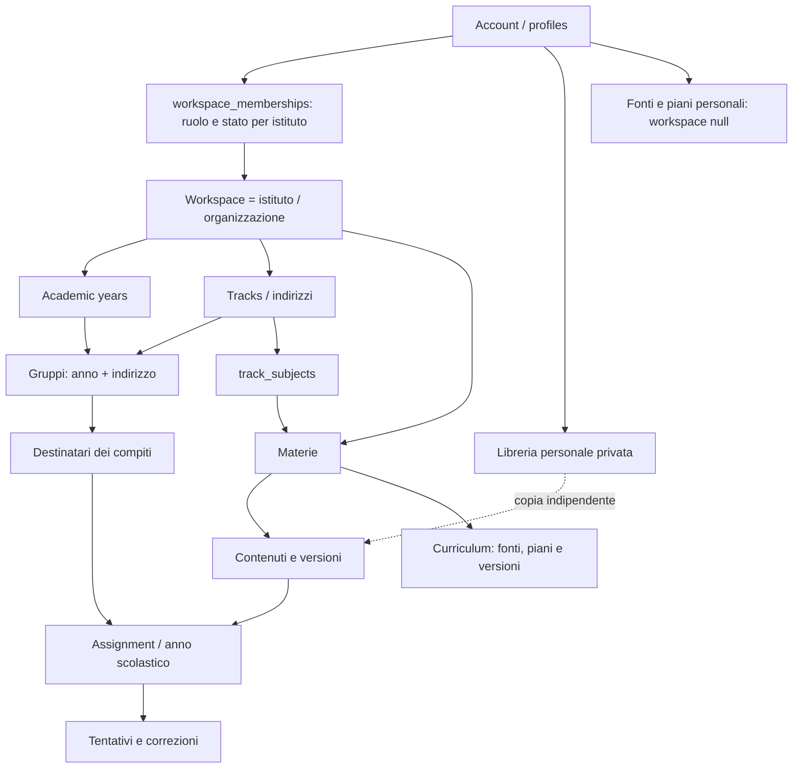

# Architettura P3.1

## Identità e autorità

`profiles` contiene l’identità globale (username, nome, cognome, stato account e cambio password). Le colonne `role` e `workspace_id` vengono migrate e rimosse. Il tipo frontend `Profile` è una proiezione di identità e membership attiva; non è un ruolo globale salvato nel database.

Una membership può assegnare Owner, Manager, Editor, Reviewer o Member. `staff_subjects` definisce gli ambiti di editor/reviewer per materia; l’istituto deriva dalla materia. La modifica di un ruolo elimina esclusivamente gli ambiti del contesto corrente. La rimozione o disattivazione dell’ultimo owner è impedita con lock transazionale.

## Contesto della richiesta

Il client aggiunge `x-workspace-id` alle chiamate REST e Edge Function, mai alle chiamate Auth. Il valore è un selettore non attendibile. `app_private.current_workspace()` legge `request.headers`, verifica l’account Auth, la membership, lo stato di disattivazione, il cambio password e l’archiviazione dell’istituto. Un header assente, malformato, revocato o non autorizzato produce `NULL`: nessun fallback privilegiato.

`my_workspaces` consente all’account pronto di scoprire esclusivamente le proprie membership. Il browser conserva ID degli ultimi contesti per account; i valori vengono validati e poi confrontati con istituti, materie e gruppi restituiti dal backend. Non sono permessi. Le schede browser possono selezionare istituti diversi perché non esiste un contesto globale mutabile sul server.

Al cambio istituto i componenti vengono rimontati e le risposte delle query obsolete ignorate. Vengono caricati solo dati del contesto attivo. Gli heartbeat della lezione conservano esplicitamente l’header del contesto in cui sono nati, anche durante il flush alla chiusura della route. Ricerca, catalogo, compiti e pagine amministrative usano lo stesso client RLS. La ricerca testuale resta con debounce.

Lo switch principale seleziona l’istituto; la barra separata gestisce anno scolastico, materia e gruppo. La palette `Ctrl/Cmd+K` usa un dialog nativo, focus e Escape. Non intercetta la scorciatoia in input, textarea, select o editor. I nomi di materie/gruppi dei contesti recenti vengono risolti soltanto per l’istituto caricato: non si interrogano tutti gli istituti per riempire la palette.

## Storico scolastico

Gli anni hanno etichetta, date e stato upcoming/active/archived; gli indirizzi sono configurabili e associabili a materie. I gruppi hanno anno e indirizzo obbligatori, con unicità del nome per istituto e anno. I compiti derivano l’anno dal gruppo destinatario, e un target di un anno differente viene rifiutato.

Archiviare un anno non cancella righe. Impedisce nuove assegnazioni, tentativi e modifiche operative dei grant dei gruppi storici; lo staff mantiene lettura di compiti, piani, risposte, review e analytics autorizzati. I contenuti sono riutilizzabili tra anni, quindi non vengono cancellati o duplicati automaticamente. Grant individuali sui contenuti restano indipendenti dall’anno: se occorre limitarli vanno revocati esplicitamente. I nuovi gruppi non ereditano membership.

## Copie personali

`personal_library_items` ha un proprietario e RLS per quel solo account. Supporta snapshot JSON di lezioni, moduli, esercizi, template compiti, configurazioni simulatori, grafici e template di moduli curriculum. La validazione frontend riusa gli schemi esistenti. La tabella limita dimensione e tipo del documento; il client non inserisce automaticamente account, risposte o attività.

Una lezione viene copiata in un istituto con `fork_personal_content`: autorizzazione della materia, lettura dello snapshot privato, nuovo ID/slug, salvataggio atomico in bozza/versione 1 e audit. `source_library_id` conserva la provenienza; il documento è copiato, non dereferenziato durante la lettura. Modifiche e cancellazione del template non alterano le copie. Gli altri template sono riutilizzabili via JSON, senza creazione automatica di compiti o grant.

## Curriculum

`curriculum_sources` conserva provenienza, ente, disciplina, percorso, articolazione, livello, data/versione, URL, testo, note e metadata del file. Le fonti possono essere personali o legate a una materia dell’istituto. Il tipo official è dichiarato dall’autore, non certificato dal software. Sono supportati testo incollato e file UTF-8 `.txt`/`.md`; non sono introdotti OCR, cloud processing o estrazione PDF non verificata.

`CurriculumPlan v1` è validato con Zod e controlli server: contesto coerente, fonti accessibili, ID univoci, ore finite/range, periodi e moduli strutturati. Il JSON del piano contiene i moduli; non servono tabelle separate per ogni argomento. `curriculum_plans` indicizza contesto e stato; `curriculum_plan_versions` conserva documenti, autore e data. Il salvataggio è transazionale e richiede la versione attesa. Il ripristino aggiunge una versione; le modifiche a un piano approvato richiedono nuova approvazione. Un import entra sempre come proposed.

Owner/manager gestiscono e approvano; editor delle materie assegnate creano/modificano; reviewer delle materie assegnate leggono; member non vede il planner interno. I piani personali sono accessibili solo al proprietario. L’anno archiviato rende i piani storici non modificabili. Una copia per un nuovo anno è un documento indipendente con stato draft, progresso e materiale effettivo azzerati; non copia dati degli utenti.

La timeline usa periodi mensili, durata, esclusione, note e pulsanti di riordino accessibili. Il budget distingue ore nominali, riserve e ore pianificabili; le ore esplicite per verifiche prevalgono sulla percentuale. I periodi esclusi sovrapposti si contano una volta. Il risultato è una stima.

Origini letterali, interpretazioni e proposte organizzative sono campi distinti. Il validatore segnala estratti non presenti, riferimenti e simulatori sconosciuti, ma non certifica completezza didattica o normativa. Il metaprompt vieta prescrizioni inventate e denominazioni ingannevoli del piano. Non sono effettuate chiamate a LLM.

`Prepara argomento` produce istruzioni separate per chi deve comprendere il tema. Il passaggio al Prompt Builder precompila materia/livello/modulo/argomento e mostra fonte/obiettivi come suggerimenti; il campo del materiale effettivamente trattato resta vuoto. La modalità Aderente e il requisito di materiale reale rimangono il contratto di pubblicazione.

## Sicurezza e operazioni

Tutte le RPC pubbliche restano SECURITY INVOKER; le implementazioni privilegiate sono in `app_private`, non esposto, con `search_path=''`, riferimenti alle tabelle qualificati ed EXECUTE esplicito. RLS copre anche le letture indirette di tentativi, review, attività, fonti e versioni. I trigger impediscono relazioni tra istituti differenti e spostamenti di contenuti/gruppi/compiti che renderebbero incoerente lo storico. Slug e ID sorgente sono univoci per istituto.

Le Edge Functions validano JWT e membership dell’header. Disattivare un account nell’istituto modifica la membership. Reset password e cancellazione globale sono ammessi soltanto per account con una sola membership; gli account condivisi richiedono un operatore globale fidato. Il cambio password personale usa solo l’identità JWT. Nessun endpoint consente l’auto-promozione.

L’audit registra membership, ruoli, anni, indirizzi, approvazioni, ripristini, eliminazione di fonti e fork; non registra cambi di contesto. Il backup v5 include struttura scolastica e curriculum dell’istituto. Il restore UI resta limitato alla configurazione e ai contenuti, è transazionale e rifiuta conflitti; identità, piani e attività non vengono ricostruiti automaticamente. Per lo storico completo serve un backup amministrativo del database.

## Distribuzione

Applicare solo la nuova migration su un database P3; su installazione nuova applicare tutte e quattro nell’ordine. Aggiornare Edge Functions e frontend insieme alla migration perché `profiles.role/workspace_id` vengono rimossi. Eseguire backup e aggiornamento in una finestra controllata. GitHub Pages resta statico; la pipeline verifica typecheck, lint, test PostgreSQL/unitari, E2E browser e build. Nessuna dipendenza operativa a pagamento e nessun upgrade automatico.
